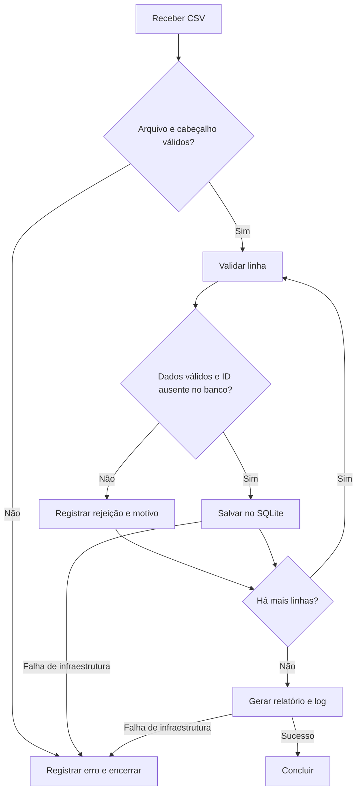

# Automação de solicitações — desafio Vintertech

[](https://github.com/gabriel-logan/teste_rpa_vintertech/actions/workflows/ci.yml)

Lê o CSV fornecido, valida as solicitações, salva as válidas em SQLite e gera rejeições, relatório e log. Usa apenas a biblioteca padrão do Python; não precisa de credenciais nem de acesso a sistemas externos.

## Status da entrega

**Concluído em 20/10/2026.** Os requisitos obrigatórios do desafio, incluindo as etapas A–F, foram conferidos. Os 37 testes automatizados passaram com Python 3.12.3, usando `python3 -m unittest discover -s tests -v`.

A execução do CSV em banco temporário vazio confirmou 12 registros lidos, 8 válidos, 4 rejeitados e R$ 3.470,00 aprovados. A reexecução manteve as mesmas 8 linhas no SQLite, sem alterações nem duplicação. Os campos persistidos, os totais por área, as rejeições com registro original e motivo, os logs e a correspondência dos CSVs gerados com as evidências versionadas também foram verificados.

## Como executar

Instale Python **3.10 ou superior**. No terminal, execute:

```bash
git clone https://github.com/gabriel-logan/teste_rpa_vintertech.git
cd teste_rpa_vintertech
python3 -m rpa
```

No Windows, substitua `python3` por `py` nos comandos. Execute dentro da pasta do repositório. Não é necessário instalar pacotes (`pyproject.toml` declara as dependências). Para usar outro CSV: `python3 -m rpa --input caminho/arquivo.csv`. Veja os demais caminhos com `python3 -m rpa --help`.

Na primeira execução, com banco vazio, o arquivo fornecido deve produzir **12 lidos, 8 válidos, 4 rejeitados, 5 aprovados, 2 pendentes e 1 cancelado**, com total aprovado de **3.470,00**. Os arquivos aparecem em `output/`:

| Arquivo | Conteúdo |
|---|---|
| `requests.sqlite` | Solicitações válidas; `schema.sql` define a tabela. |
| `rejections.csv` | Campos principais, registro original completo em `original_record` (JSON) e motivo (`reason`). |
| `report.csv` | Contagens do lote e soma aprovada por área. |
| `execution.log` | Início, fim, contagens e erros, sem descrições dos registros. |

Exemplos gerados com o CSV fornecido estão em `evidence/`: `sample_report.csv` e `sample_rejections.csv` mostram a primeira execução; `sample_rerun_report.csv` e `sample_rerun_rejections.csv` mostram a reexecução no mesmo banco. `execution.txt` contém o log das duas execuções.

## Como testar

```bash
python3 -m unittest discover -s tests -v
```

Os testes usam arquivos temporários e cobrem validação, duplicidade no lote e entre execuções, preservação dos registros rejeitados, campos grandes, falhas de infraestrutura e rollback no banco.

Para conferir a idempotência manualmente, rode `python3 -m rpa` duas vezes, começando com um banco vazio: o banco continuará com **8** solicitações. Na segunda execução, o relatório terá **12 lidos, 0 válidos, 12 rejeitados, 0 aprovados, 0 pendentes, 0 cancelados e total aprovado de 0,00**. São 9 ocorrências de IDs já persistidos e 3 registros com dados inválidos. Cada execução substitui os CSVs de saída e acrescenta mensagens ao log.

O relatório descreve somente o lote atual: válidos são os registros novos persistidos nessa execução; rejeitados incluem os duplicados. As contagens por status e os totais financeiros consideram apenas os novos registros válidos. Dados já salvos não são sobrescritos nem somados novamente.

O GitHub Actions executa os testes automaticamente em cada push e pull request. Após um push em `main` bem-sucedido, o pacote fica disponível na aba **Actions**, em **Artifacts** da execução, por 14 dias.

## Regras e possíveis erros

O CSV precisa ter codificação UTF-8 (BOM aceito), separador `;` e os campos `id_solicitacao`, `data`, `area`, `descricao`, `valor` e `status`. Data deve ser `AAAA-MM-DD`; valor deve usar formato brasileiro, como `1.250,50`, e ser maior que zero. Os status aceitos são `Aprovado`, `Pendente` e `Cancelado`. Só aprovados entram na soma; todos os status válidos são salvos. Apenas a primeira ocorrência válida de cada ID é mantida; as demais são registradas como duplicadas, inclusive quando o ID foi persistido em uma execução anterior. Um ID já salvo tem prioridade como motivo de rejeição, mesmo que a nova ocorrência também contenha dados inválidos. Valores monetários são tratados com `Decimal` para preservar centavos.

O limite de leitura de cada campo CSV é ajustado ao tamanho do arquivo de entrada, permitindo descrições maiores que o limite padrão de 128 KiB do Python. Campos com ponto e vírgula, aspas ou quebras de linha são aceitos quando delimitados conforme o formato CSV e também são preservados nas rejeições.

Linhas com dados incorretos vão para `rejections.csv` e o processamento continua. `original_record` preserva os pares de campo e valor na ordem recebida, inclusive campos adicionais; colunas sem cabeçalho aparecem com nome `null` no JSON. Arquivo ausente, cabeçalho incompleto ou duplicado, codificação inválida ou falha no banco/saída encerram a execução com erro no terminal e no log, quando possível. Cabeçalhos duplicados são rejeitados antes de processar as linhas, inclusive em colunas adicionais. Se o comando Python não for reconhecido, confira a instalação. Se houver erro de permissão, execute em uma pasta onde seja possível criar `output/`.

## Fluxo do processo

**AS-IS:** recebimento do CSV, conferência manual, lançamento dos pedidos e montagem do relatório.

**TO-BE:** leitura automática, validação, registro das rejeições, persistência sem duplicação e relatório; exceções de infraestrutura encerram a execução.



## Perguntas técnicas

1. **Como evitar lançamento duplicado?** Consulto o ID no banco antes da validação e registro repetições como rejeições. A chave única e o tratamento de conflito na inserção garantem idempotência entre execuções. Apenas inserções efetivas entram nas contagens e nos totais financeiros.
2. **Dado ou infraestrutura?** Dado inválido rejeita só a linha. Falha de arquivo, codificação ou banco encerra o lote com erro.
3. **API ou interface?** Prefiro API documentada quando disponível; uso RPA pela interface se o processo depender dela.
4. **Credenciais?** Usaria um gerenciador de segredos, acesso mínimo e rotação, nunca código ou logs.
5. **Indicadores?** Sucesso, duração, volume, rejeições, duplicados, valores por área e tempo desde a última execução.

## Discussão técnica

Para buscar dados em um portal, verificaria primeiro uma API autorizada; sem API, usaria automação de navegador para obter o lote e reutilizaria esta validação. Em indisponibilidade, registraria a falha, tentaria novamente com espera crescente e alertaria após tentativas limitadas. A chave única permite reprocessar com segurança. Um agendador, como cron, executaria o comando periodicamente, com alerta por código de saída e controle para evitar execuções simultâneas.

## Uso de IA

IA auxiliou na elaboração dos testes, do código e deste README. O resultado foi conferido com os testes automatizados e com a execução do CSV fornecido.
