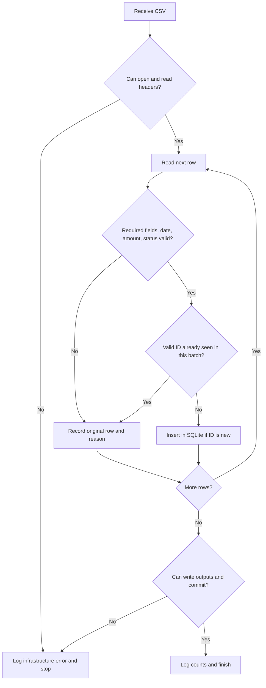

# Vintertech RPA challenge

This Python application processes administrative requests from the supplied CSV, validates them, stores accepted requests in SQLite, and writes a rejection file and an execution report. It runs locally and uses only the Python standard library.

## Installation

Use Python 3.10 or newer. No third-party packages or credentials are required. Clone the repository and run the commands below from its root. Dependencies and the supported Python version are declared in `pyproject.toml`.

## Run

```bash
python3 -m rpa
```

The default input is `data/dados_teste_rpa.csv`. The command creates `output/requests.sqlite`, `output/rejections.csv`, `output/report.csv`, and `output/execution.log`. The input is UTF-8 with an optional BOM and uses semicolons.

To choose paths explicitly:

```bash
python3 -m rpa \
  --input data/dados_teste_rpa.csv \
  --db output/requests.sqlite \
  --rejections output/rejections.csv \
  --report output/report.csv \
  --log output/execution.log
```

Each output path is a file; missing parent directories are created. The command exits with a nonzero status for missing input, missing required CSV headers, unreadable data, or unavailable output storage. It reports the failure on stderr and in the log when logging is available. A data error in an individual row does not stop the batch.

## Output contract and decisions

The required input headers are `id_solicitacao`, `data`, `area`, `descricao`, `valor`, and `status`. They are preserved in the rejection CSV, alongside an English `reason` column. Output CSVs also use semicolons and UTF-8 with BOM, so they open cleanly in common spreadsheet tools.

Dates must be real dates in `YYYY-MM-DD` form. Brazilian amounts such as `350,00` and `1.250,50` are parsed with `Decimal`; zero, negative, malformed, and empty values are rejected. Whitespace-only required fields are empty. Only `Aprovado`, `Pendente`, and `Cancelado` are accepted as statuses. Valid pending and canceled requests remain in SQLite; only approved amounts contribute to financial totals.

Only the first **valid** occurrence of a request ID in an input batch is accepted. Later occurrences are written as duplicates; an invalid row does not reserve its ID. The SQLite `requests.request_id` primary key and `ON CONFLICT DO NOTHING` provide idempotency across executions. An existing request is never overwritten by a later batch. The report and rejection file describe the current input batch, including a repeat run; the database retains previously accepted rows. Database writes run in a transaction and roll back if batch processing fails.

The report contains one `TOTAL` row with `records_read`, `valid`, `rejected`, `approved`, `pending`, `canceled`, and `approved_total`. It also contains one `AREA` row per area seen in valid input, with its approved amount. Amounts in the database and report are decimal text with two fractional digits to avoid binary floating-point rounding. The `schema.sql` script defines the table and its unique key.

Logs record start, end, counts, row numbers, and error categories without logging descriptions or monetary values. Input validation failures are data errors; file, encoding, and SQLite failures are infrastructure errors. The `evidence/` directory contains generated sample outputs and an execution log from the supplied CSV.

## Test

```bash
python3 -m unittest discover -s tests -v
```

The test suite covers the supplied file, each required field, money and date validation, status handling, duplicate IDs, approved totals by area, an empty file, malformed headers, missing input, unavailable database, logs, and rerunning the same batch. Tests use temporary directories and do not change the sample data.

## Process mapping

**AS-IS:** An operator receives a CSV, manually checks fields and amounts, compares request IDs with previous entries, enters accepted requests in a register, records rejected requests, and builds a summary report. Manual validation and repeated entry can miss errors or create duplicates.

**TO-BE:** The application reads the CSV, validates each row, records data errors, checks for duplicates, writes accepted requests to SQLite, and produces the report. A file or database exception stops the run, logs the error, and returns a failure status for operational follow-up.



## Technical questions

1. **How is duplicate entry prevented?** The in-memory set detects later valid occurrences in the same file. The SQLite primary key enforces uniqueness across runs and keeps the first stored value, even if another process tries to insert it.
2. **How are data and infrastructure errors distinguished?** A row with invalid content is rejected with its original values and a reason, while the batch continues. A missing input, malformed header, encoding failure, or unavailable database fails the run with a nonzero exit code and an error log.
3. **When use an API instead of interface RPA?** Use a documented, authorized API when it exposes the needed data and operations: structured responses and stable contracts are easier to validate than browser screens. Use interface automation only when no suitable API exists or the process requires the UI.
4. **How would credentials be protected?** Retrieve them at runtime from a secret manager or protected environment, grant the smallest required permissions, rotate them, and never put them in source, CSV outputs, logs, or screenshots.
5. **Which production indicators matter?** Monitor run success rate, duration, records read, valid and rejected counts, rejection reasons, duplicate rates, approved totals by area, and time since the last successful run. Alert on abnormal failure or volume changes.

## Technical discussion

To ingest requests from a web portal, I would first check for an authorized API or export endpoint. If the portal only offers a UI, a browser automation would authenticate using a protected credential source, wait for explicit page states, download or extract a batch, and pass it to the same validation and persistence flow. The portal adapter would keep source access separate from the CSV processing rules.

For an outage, I would record a run-level infrastructure error and avoid marking unseen requests as processed. Limited retries with backoff would handle transient timeouts; repeated failures would trigger an alert. The unique database key would prevent duplicate inserts after recovery. An operator could rerun the same batch safely and inspect the log and rejection file.

A scheduler such as cron or a managed job runner could launch the command on a fixed schedule. Each run should have an isolated log, observable exit status, and a lock or orchestration rule to prevent overlapping jobs. Monitoring would track success, duration, input age, row counts, and rejection trends.

## AI usage

AI assisted with drafting the test suite, implementation, and README. The behavior was checked by running the automated tests and processing the supplied CSV; generated examples in `evidence/` come from that run.
